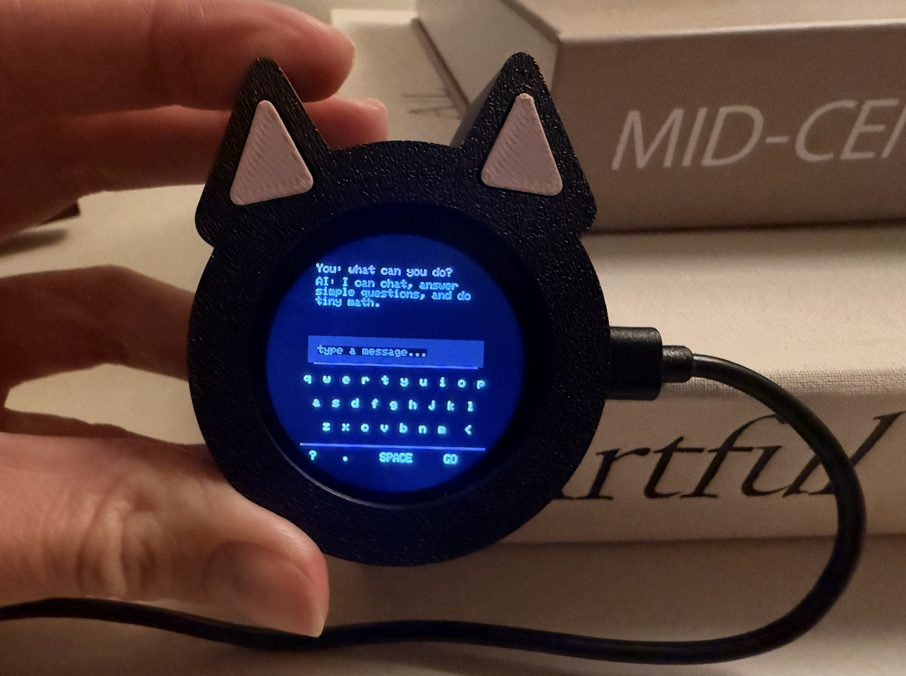

# PocketGPT on ESP32-S3



An experimental 30.46-million-parameter language model running directly on an ESP32-S3, with an alternative XIAO touchscreen interface for Gemini or Ollama.

| Project | Inference location | Status |
|---|---|---|
| `espdev_ai/firmware` | ESP32-S3 DevKit, 32 MB Flash / 16 MB PSRAM | Source and recorded hardware results |
| `xiao_ai/keyboard_interfaces/xiao_local` | XIAO ESP32-S3, 8 MB Flash / 8 MB PSRAM, Seeed Round Display and microSD | Built and tested on XIAO over USB; touch input confirmed by user |
| `xiao_ai/keyboard_interfaces/xiao_network` | Gemini servers or a computer running Ollama | Code provided; compile-checked, not network hardware-tested |

The offline model is small and makes mistakes, including arithmetic errors. It is a research/demo project, not a general-purpose assistant. Retained DevKit measurements and the latest XIAO UI validation are in the respective `recorded_results` folders. See [release status](docs/RELEASE_STATUS.md) for the scope of each check.

## What can PocketGPT actually do?

PocketGPT is an experimental language model with limited capabilities. It demonstrates language-model inference directly on an ESP32-S3, including a touchscreen keyboard on XIAO. The offline firmware runs without a cloud service or internet connection.

It can produce short greetings, basic conversational replies and responses to some familiar prompts. These examples are actual recorded hardware outputs:

| Board | Prompt | Recorded response |
|---|---|---|
| XIAO ESP32-S3 | `hello` | `Hello.` |
| XIAO ESP32-S3 | `how are you?` | `I'm doing okay.` |
| ESP32-S3 DevKit | `say something nice` | `You're doing better than you think.` |

Sources: [XIAO USB test](xiao_ai/recorded_results/ui_2026-10-13/serial_results.txt) and [DevKit test](espdev_ai/recorded_results/2026-10-12_tied30m_dedup_devkit/tests/03.txt). These examples show specific successful prompts, not reliable performance on arbitrary questions.

Answers can be incorrect, repetitive or unrelated to the question. Even basic arithmetic is unreliable. PocketGPT is not comparable to ChatGPT or Gemini and should not be relied on for factual answers or advice. A displayed keyboard lets you enter text; it does not imply that the model understands every possible input.

Responses also take time: the recorded XIAO `hello` test took about 6.4 seconds from request to completion; `how are you?` took about 11.8 seconds. Speed depends on the board, prompt, output length and firmware configuration. See the linked logs for the measurements.

Gemini and Ollama are separate network options: their answers come from a cloud server or another computer. Their capabilities do not describe the model running on the ESP32 itself.

## Amazon link

[View on Amazon](https://amzn.to/4B00LyJ)

## Get started

- **[Connect XIAO to Gemini or Ollama — step-by-step](docs/NETWORK_SETUP.md)**
- [Build and installation](docs/BUILD.md)
- [Official GCC16 setup](docs/TOOLCHAIN.md)
- [Model and artifact formats](docs/MODEL_CARD.md)
- [Data provenance](docs/DATA_PROVENANCE.md)
- [Third-party inventory](docs/THIRD_PARTY.md)
- [Release status and omissions](docs/RELEASE_STATUS.md)
- [Privacy](docs/PRIVACY.md)
- [MIT license and exclusions](LICENSE_STATUS.md)

Run `python3 -B tools/verify_release.py .` before publishing to screen local metadata and common secret patterns. It does not verify file integrity, contact hardware, or guarantee the absence of every secret. The optional root checksum list was removed.

This repository contains the code for running PocketGPT, but does not include its trained weights or tokenizer files. Both are required to run the local model on a newly provisioned board. Their distribution terms are still being reviewed; no asset download is published yet. This does not imply that the model was initialized from pretrained weights. Whole-board backups and credentials are excluded. The Gemini/Ollama interface does not require PocketGPT weights.

## Training source

[Original architecture, training scripts and reproducibility limits](training/README.md) are included. These document the historical Base V2 run; they are not a complete downloadable training corpus or the full later repair pipeline.

## Serial testing

Install `python3 -m pip install -r requirements.txt`, then run:

```sh
python3 tools/serial_test.py --port /dev/ttyACM0 --output serial-results --hello-only
```

Windows: use `--port COM3`; macOS: use your actual `/dev/cu.usbmodem...` device. This command opens the selected port and sends a prompt after the expected DevKit boot. Reset the board after starting if necessary. Logs are local outputs; review them before sharing.

The XIAO local UI was subsequently installed and tested on 2026-10-13 after a verified private backup. See `xiao_ai/recorded_results/ui_2026-10-13/`.

## Source layout

| File or folder | Purpose |
|---|---|
| `espdev_ai/firmware/src/main.cpp` | DevKit offline model and USB chat entry point |
| `xiao_ai/keyboard_interfaces/xiao_local/src/main.cpp` | XIAO offline model and touchscreen entry point |
| `model_storage.inc` | Access to model matrices across Flash, PSRAM and SD |
| `output_projection.inc` | Quantized output projection and repair rows |
| `model_offsets.h`, `model_layout.h`, `model_storage_layout.h`, `model_storage_checksums.h` | Model-specific binary layout and validation constants; do not interchange between boards |
| `q4_*.inc` | Quantized matrix kernels and dispatch |
| `batched_*.inc`, `two_token_*.inc`, `prompt_prefill.inc` | Batched prompt processing |
| `xiao_ai/keyboard_interfaces/xiao_network/xiao_network.ino` | Gemini/Ollama network sketch |
| `touchscreen_keyboard.h` | Network sketch display and input interface |
| `google_root_certificates.h` | Public Google TLS trust certificates; not secret keys |
| `platformio.ini`, `partitions_*.csv`, `check_firmware_size.py` | Board build, Flash layout and XIAO size guard |

Implementation fragments ending in `.inc` are included by the main source; they are not standalone programs. Third-party display filenames retain their upstream names. Runtime model asset names and historical test logs retain their original identifiers.
